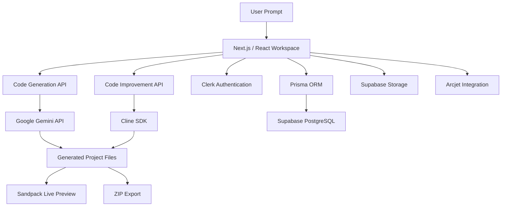

# ⚡ Forge — Agentic AI App Builder

### From natural-language prompts to interactive React applications.

Forge is a full-stack, AI-powered application builder that transforms natural-language instructions into React applications. It combines AI code generation, an interactive development workspace, live previews, and agent-assisted code improvement in one platform.

Inspired by the next generation of AI development tools, Forge explores how LLMs and AI agents can simplify application prototyping and accelerate developer workflows.

**Built with Next.js, React, TypeScript, Gemini AI, the Cline SDK, Supabase, and Prisma.**

<p align="center">
  <a href="https://agentic-ai-app-builder.vercel.app/">
    
  </a>
  <a href="https://github.com/RajpurohitYespal/Agentic-AI-App-Builder">
    
  </a>
</p>

<p align="center">
  
  
  
  
</p>

---

## 📸 Preview

**Try Forge:** [https://agentic-ai-app-builder.vercel.app/](https://agentic-ai-app-builder.vercel.app/)

Explore the application and its AI-assisted development workflow.

> Screenshots of the landing page, workspace, generated code, and live preview can be added here to showcase the interface.

<!-- Add screenshots to a screenshots/ folder and uncomment this section when available.
<p align="center">
  
</p>
<p align="center">
  
</p>
-->

---

## 📋 Table of Contents

- [Overview](#-overview)
- [Features](#-features)
- [Tech Stack](#-tech-stack)
- [Architecture](#-architecture)
- [Project Structure](#-project-structure)
- [Getting Started](#️-getting-started)
- [Environment Variables](#-environment-variables)
- [Database Setup](#️-database-setup)
- [Deployment](#️-deployment)
- [Engineering Highlights](#-engineering-highlights)
- [Future Improvements](#-future-improvements)
- [Author](#-author)

---

## 🚀 Overview

Traditional application development involves setting up projects, writing components, managing dependencies, and repeatedly testing changes.

Forge provides an AI-assisted workflow in which users describe an application, receive generated React code, inspect the files, and preview the result directly in the browser.

The workspace also supports follow-up instructions to improve generated applications, persistent project data, image uploads, and ZIP export.

The project brings together modern full-stack development and agentic AI concepts in a single application.

### The workflow

1. Describe an application using a natural-language prompt.
2. Generate React application code using AI.
3. Inspect generated files in the development workspace.
4. Preview the application interactively.
5. Request AI-assisted changes and improvements.
6. Save projects and export generated files.

---

## ✨ Features

### 🤖 AI-Powered Code Generation

- Generate React application code from natural-language prompts.
- Integrate Google's Gemini API for AI-powered generation.
- Return structured generation results for the workspace.
- Handle generated project files and dependency information.

### 👨‍💻 Interactive Development Workspace

- Dedicated chat and code panels.
- Explore generated project files.
- Switch between code and live-preview views.
- Render generated React applications using Sandpack.
- Continue iterating on an application through follow-up prompts.

### 🧠 Agent-Assisted Code Improvement

- Integrate the Cline SDK for AI-assisted code modifications.
- Support file updates through the improvement workflow.
- Reflect code changes in the workspace and preview.

### 🛠️ AI-Assisted Error Fixing

- Use preview error context to help diagnose application issues.
- Send relevant context through the AI improvement workflow.
- Generate revised code to help resolve errors.

### 💾 Project and Workspace Management

- Store application data in PostgreSQL.
- Associate application records with authenticated users.
- Save and retrieve workspace information.
- Browse and manage existing projects.

### 🖼️ Image Upload and Project Export

- Upload images using Supabase Storage.
- Use uploaded image URLs in the application-building workflow.
- Export generated project files as a ZIP archive using JSZip.

### 🔐 Authentication and Credits

- Clerk-powered authentication.
- User records integrated with the application database.
- Credit-based generation and improvement workflows.
- Plan-related logic for controlling access to features.

### 🛡️ Security Integration

- Arcjet integration for application protection.
- Environment-based configuration for sensitive credentials.
- Database access through Prisma and PostgreSQL.

---

## 🧰 Tech Stack

| Category | Technologies |
|---|---|
| Framework | Next.js 16 App Router |
| Frontend | React 19, TypeScript |
| Styling | Tailwind CSS v4, shadcn/ui |
| AI Code Generation | Google Gemini API |
| AI Code Improvement | Cline SDK |
| Code Editor and Preview | CodeMirror, Sandpack |
| Authentication | Clerk |
| Database | PostgreSQL through Supabase |
| ORM | Prisma |
| File Storage | Supabase Storage |
| ZIP Export | JSZip |
| Security Integration | Arcjet |
| Deployment | Vercel |

---

## 🏗️ Architecture

Forge separates the user interface, AI workflows, and persistence layer to support an iterative application-building experience.



### Main workflows

**1. Generate an application**

The user submits a natural-language prompt → the generation API calls Gemini → generated files are returned to the workspace → Sandpack renders the application preview.

**2. Improve an application**

The user submits an improvement instruction → the improvement API invokes the Cline SDK workflow → file modifications are applied → the workspace reflects the updated code.

**3. Save and retrieve projects**

Prisma interacts with PostgreSQL to persist and retrieve user and workspace data according to the application's database schema.

**4. Export a project**

Generated project files are packaged into a ZIP archive so users can download the files for further development.

---

## 📁 Project Structure

```text
Agentic-AI-App-Builder/
├── actions/
│   ├── projects.ts
│   └── workspace.ts
├── app/
│   ├── (auth)/
│   │   ├── sign-in/
│   │   └── sign-up/
│   ├── (main)/
│   │   ├── projects/
│   │   └── workspace/
│   ├── api/
│   │   ├── gen-ai-code/
│   │   │   └── route.ts
│   │   └── improve/
│   │       └── route.ts
│   ├── globals.css
│   ├── layout.tsx
│   └── page.tsx
├── components/
│   ├── ChatPanel.tsx
│   ├── CodePanel.tsx
│   ├── WorkspaceClient.tsx
│   └── ...
├── lib/
│   ├── checkUser.ts
│   ├── prisma.ts
│   └── ...
├── prisma/
│   ├── migrations/
│   └── schema.prisma
├── types/
├── public/
├── proxy.ts
├── prisma.config.ts
├── package.json
└── README.md
```

### Important files

| File | Responsibility |
|---|---|
| `app/api/gen-ai-code/route.ts` | AI code-generation endpoint |
| `app/api/improve/route.ts` | AI-assisted code-improvement endpoint |
| `components/WorkspaceClient.tsx` | Main workspace interface |
| `components/ChatPanel.tsx` | Prompt and conversation interface |
| `components/CodePanel.tsx` | Code viewing and live-preview interface |
| `actions/projects.ts` | Project-related server actions |
| `actions/workspace.ts` | Workspace-related server actions |
| `lib/checkUser.ts` | User-related application logic |
| `lib/prisma.ts` | Prisma client setup |
| `prisma/schema.prisma` | Database models and relationships |

---

## ⚙️ Getting Started

### Prerequisites

Before running Forge locally, make sure you have:

- Node.js 22 or later, compatible with the project's dependencies.
- npm.
- A Clerk application.
- A Supabase project with PostgreSQL and Storage configured.
- A Google Gemini API key.
- An Arcjet API key for the configured security integration.

### 1. Clone the repository

```bash
git clone https://github.com/RajpurohitYespal/Agentic-AI-App-Builder.git

cd Agentic-AI-App-Builder
```

### 2. Install dependencies

```bash
npm install
```

### 3. Configure environment variables

Create a `.env` file in the project root and add the variables listed in the [Environment Variables](#-environment-variables) section.

Use credentials from your own service accounts. Do not copy production secrets into source code or commit them to Git.

### 4. Set up the database

Confirm that your database connection strings point to the intended PostgreSQL database.

Apply the existing migrations:

```bash
npx prisma migrate deploy
```

Generate the Prisma Client if needed:

```bash
npx prisma generate
```

Follow the repository's Prisma configuration for the installed Prisma version and database connection setup.

### 5. Start the development server

```bash
npm run dev
```

Visit [http://localhost:3000](http://localhost:3000).

### 6. Run a production build

```bash
npm run build
```

---

## 🔑 Environment Variables

Create a local `.env` file in the project root:

```env
# Clerk Authentication
NEXT_PUBLIC_CLERK_PUBLISHABLE_KEY=
CLERK_SECRET_KEY=
NEXT_PUBLIC_CLERK_SIGN_IN_URL=/sign-in
NEXT_PUBLIC_CLERK_SIGN_UP_URL=/sign-up

# Supabase
NEXT_PUBLIC_SUPABASE_URL=
NEXT_PUBLIC_SUPABASE_ANON_KEY=

# PostgreSQL / Prisma
DATABASE_URL=
DIRECT_URL=

# Google Gemini
GEMINI_API_KEY=

# Arcjet
ARCJET_KEY=
```

### Where to obtain credentials

| Variable | Source |
|---|---|
| Clerk keys | Clerk Dashboard |
| Supabase URL and API key | Supabase Project Settings / API |
| Database connection strings | Supabase Database Settings |
| Gemini API key | Google AI Studio |
| Arcjet key | Arcjet Dashboard |

**Important:** Use the exact variable names and connection formats expected by the project configuration. The database URLs may differ depending on whether a pooled or direct PostgreSQL connection is used.

### Security best practices

- Never commit `.env` or `.env.local` files.
- Never expose server-side API keys in client-side code.
- Use environment variables for local development and Vercel environment settings for deployment.
- Use separate development and production credentials where appropriate.
- Rotate credentials immediately if they are exposed.
- Review Supabase Storage policies and upload validation before production use.

---

## 🗄️ Database Setup

Forge uses Prisma to interact with PostgreSQL hosted on Supabase.

### User

The user model stores application-level user information associated with Clerk authentication, along with account and plan-related fields defined in the Prisma schema.

### Workspace

The workspace model stores project information and supports persistence of workspace data, conversations, and generated project files according to the schema.

### Storage

The `workspace-images` Supabase Storage bucket is used by the image-upload workflow.

Before production use, configure access policies, upload validation, and permissions appropriate to the application.

---

## ☁️ Deployment

Forge is deployed on Vercel.

**Live application:** [https://agentic-ai-app-builder.vercel.app/](https://agentic-ai-app-builder.vercel.app/)

To deploy your own instance:

1. Push the repository to GitHub.
2. Import the repository into Vercel.
3. Add the required environment variables in the Vercel project settings.
4. Verify that the production database is reachable.
5. Apply the required database migrations.
6. Configure Clerk's production instance, domains, and redirect settings.
7. Verify Supabase Storage configuration and policies.
8. Deploy the application.
9. Test authentication, AI generation, code improvement, project persistence, image uploads, and ZIP export.

A successful local build is a useful checkpoint, but it does not replace testing the deployed application.

---

## 💡 Engineering Highlights

Forge demonstrates practical experience with:

- Integrating LLM APIs into a full-stack application workflow.
- Designing API endpoints for AI generation and improvement tasks.
- Working with AI agent SDKs and tool-assisted file modifications.
- Rendering generated React code in an interactive preview environment.
- Managing relational data with PostgreSQL and Prisma.
- Integrating authentication into application workflows.
- Handling generated files, image uploads, and ZIP exports.
- Organizing a modern Next.js application into reusable components and API routes.
- Configuring external services and preparing an application for cloud deployment.

These concepts are relevant to AI-powered developer tools, full-stack engineering, and agentic application development.

---

## 🔮 Future Improvements

Potential areas for further development include:

- Automated testing of generated applications.
- Stronger validation and sandboxing of generated code.
- Improved recovery from AI generation and preview failures.
- Workspace version history and rollback.
- More comprehensive API validation and rate limiting.
- Better visibility into generation progress and errors.
- Deployment previews for individual generated applications.
- Usage monitoring and more detailed AI cost tracking.
- Support for additional frontend frameworks and project templates.

---

## 👨‍💻 Author

**Yashpal Rajpurohit**

Full Stack Developer | React.js | Next.js | Node.js | TypeScript | AI Applications

- **GitHub:** [@RajpurohitYespal](https://github.com/RajpurohitYespal)
- **LinkedIn:** [Yashpal Rajpurohit](https://www.linkedin.com/in/yashpal-rajpurohit-5561ba226/)
- **Live Demo:** [Forge — Agentic AI App Builder](https://agentic-ai-app-builder.vercel.app/)
- **Repository:** [Agentic AI App Builder](https://github.com/RajpurohitYespal/Agentic-AI-App-Builder)

---

⭐ If you find this project interesting, consider giving the repository a star.

*Forge explores how full-stack engineering, LLMs, and AI agents can work together to create an interactive application-building experience.*
